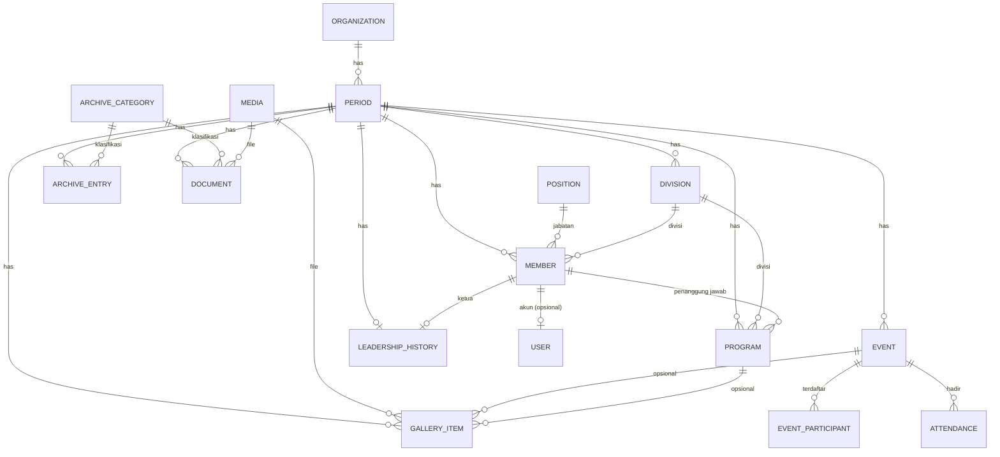

# IBKAMA UMY — Arsitektur & Rencana Implementasi

Website ini adalah **Digital Organization Management Platform**: pusat informasi, data, dokumentasi, dan arsip organisasi yang tetap berlaku lintas periode kepengurusan.

## 1. Stack

| Lapisan | Pilihan | Alasan |
|---|---|---|
| Framework | Next.js 16 (App Router, Server Components, Server Actions) | Satu codebase untuk public + dashboard + API |
| Bahasa | TypeScript | Aman untuk serah-terima antar pengurus |
| Styling | Tailwind CSS 4 + design token di `globals.css` | Konsisten, mudah diubah |
| Database | SQLite (libsql) via Drizzle ORM | Relasional, satu file, tanpa server DB; skema dapat dipindah ke Postgres/Turso |
| Auth | Sesi JWT (`jose`) di cookie httpOnly + `bcryptjs` | Tanpa layanan pihak ketiga, tanpa biaya |
| Validasi | Zod | Validasi di server pada setiap mutasi |
| Animasi scroll | GSAP ScrollTrigger + video/frame scrubbing | Kontrol progres berbasis scroll yang presisi |
| QR | `qrcode` | Generate QR di server |
| Media | Penyimpanan file lokal `storage/` + tabel `media` | Metadata terhubung ke periode/program/event |

Tidak ada AI, chatbot, n8n, atau API berbayar (di luar scope).

## 2. Sitemap

```
PUBLIC
/                       Home (storytelling: cinematic #1 → … → #3 → kontak)
/profil                 Profil, sejarah, visi, misi, tujuan, nilai, kontak
/program                Program kerja  (?periode=&divisi=&status=)
/program/[id]           Detail program
/event                  Event & kalender (?periode=&bulan=)
/event/[id]             Detail event
/arsip                  Arsip organisasi (periode × kategori)
/arsip/[periode]        Isi arsip satu periode
/kepengurusan           Struktur kepengurusan (?periode=)
/leadership             Ketua umum lintas periode (timeline)
/dokumentasi            Galeri dokumentasi
/kontak                 Kontak & integrasi
/hadir/[kode]           Halaman presensi QR (tanpa login)
/login                  Login admin

DASHBOARD (/admin) — wajib login
/admin                  Ringkasan
/admin/periode          Kelola periode           [SUPER ADMIN]
/admin/kepengurusan     Divisi & jabatan
/admin/anggota          Anggota/pengurus
/admin/program          Program kerja
/admin/event            Event
/admin/event/[id]/presensi   QR + rekap kehadiran
/admin/arsip            Kategori & entri arsip
/admin/dokumen          Dokumen
/admin/dokumentasi      Galeri
/admin/leadership       Riwayat ketua umum
/admin/pengguna         Pengguna & peran         [SUPER ADMIN]
/admin/organisasi       Profil organisasi        [SUPER ADMIN]
/admin/integrasi        Google Forms/Calendar/Drive/WA/IG [SUPER ADMIN]
```

## 3. Model data (ERD)



Aturan inti:
- Semua data organisasi yang berubah membawa `period_id`. Periode lama **tidak pernah dihapus**; hanya berstatus `archived`.
- Hanya **satu** periode `active` pada satu waktu (dijaga di transaksi `setActivePeriod`).
- ID unik (`text`, nanoid-style); nama tidak pernah jadi primary key.
- Kolom publik dan privat dipisah: query publik memakai *select whitelist* (`publicMemberColumns`), sehingga NIM, email, HP anggota tidak dapat bocor.
- Konfigurasi organisasi (identitas, kontak) disimpan di tabel `organization` dan diisi awal dari data resmi; dapat diedit Super Admin.

## 4. Matriks peran

| Sumber daya | PUBLIC | ADMIN | SUPER ADMIN |
|---|---|---|---|
| Halaman publik (data `isPublic`) | baca | baca | baca |
| Presensi via QR | isi | isi | isi |
| Program, event, arsip, dokumen, dokumentasi | baca (publik) | CRUD | CRUD |
| Anggota & kepengurusan, leadership | baca (kolom publik) | CRUD | CRUD |
| Data privat anggota, dokumen internal | – | baca/ubah | penuh |
| Rekap presensi & ekspor | – | baca/ekspor | penuh |
| Periode (buat/aktifkan/arsipkan) | – | baca | **penuh** |
| Pengguna & peran | – | – | **penuh** |
| Profil organisasi, integrasi | baca (publik) | baca | **penuh** |

Implementasi: `src/lib/permissions.ts` memetakan `role → resource:action`. Semua Server Action memanggil `requirePermission(resource, action)`; `proxy.ts` hanya pemeriksaan optimistis (redirect), otorisasi sebenarnya ada di *Data Access Layer*. Kolom `users.permissions` (JSON) disiapkan untuk override granular di masa depan. Jabatan admin (Ketua Umum, Sekretaris, Bendahara, Ketua/Sekretaris Divisi) disimpan sebagai label pada pengguna agar izin per jabatan bisa diperinci kelak.

## 5. Arsitektur kode

```
src/
  app/
    (public)/…            halaman publik (layout: Navbar + Footer)
    (auth)/login          login
    admin/…               dashboard (layout: Sidebar + Topbar)
    hadir/[kode]          presensi QR
    media/[id]/route.ts   penyaji file dengan cek visibilitas
    api/…                 export CSV, QR
  db/
    schema.ts             seluruh tabel Drizzle
    index.ts              koneksi
    seed.ts               data organisasi resmi + kategori arsip + super admin (dari env)
  lib/
    auth/                 session, password, dal (verifySession, requirePermission)
    permissions.ts        matriks peran
    queries/              query baca (publik & admin) — satu-satunya tempat akses DB untuk baca
    actions/              Server Action per modul (mutasi)
    resources/            definisi CRUD berbasis konfigurasi (kolom, field, validasi)
    integrations/         registry integrasi eksternal (placeholder terkonfigurasi)
    media.ts              simpan/baca file
  components/
    ui/                   Button, Badge, Card, Modal, Table, Form, Toast, EmptyState, Skeleton …
    public/               Navbar, Footer, SectionHeader, EventCard, ProgramCard, MemberCard, Timeline, Calendar …
    admin/                Sidebar, Topbar, StatCard, ResourceTable, ResourceForm, ConfirmDialog, Uploader
    cinematic/            ScrollVideo, CinematicSection
  content/                teks/konfigurasi statis non-organisasi (label UI, konfigurasi cinematic)
storage/                  upload (di luar public/, dilayani lewat /media/[id])
public/brand, public/cinematic   logo, poster, placeholder video
```

**Prinsip:** konten dinamis tidak pernah ada di komponen UI. Komponen menerima props dari `queries/`. Definisi CRUD berbasis konfigurasi (`lib/resources`) membuat menambah modul baru cukup satu berkas konfigurasi — penting untuk serah-terima.

## 6. Alur data

```
Admin → Dashboard (form) → Server Action → requirePermission → zod → Drizzle → SQLite
                                                                   ↓ revalidatePath
Publik → Server Component → queries/public (kolom publik saja, filter periode) → HTML
Presensi: Admin buka event → kode acak → QR → peserta scan → /hadir/[kode] → attendance → rekap → CSV
```

## 7. Strategi animasi scroll sinematik

Komponen `CinematicSection` (tinggi section 300–500vh, konten `position: sticky`):
1. Membaca konfigurasi dari `content/cinematic.ts` (path video, poster, durasi, teks overlay).
2. **Desktop:** `<video muted playsInline preload="auto">`; GSAP ScrollTrigger (`scrub`) memetakan progres scroll → `video.currentTime`. Berhenti scroll = berhenti di frame itu; scroll balik = mundur. Video harus dienkode dengan keyframe rapat (`-g 1` / `-g 2`) agar seek mulus.
3. **Mobile / hemat data / `prefers-reduced-motion`:** menampilkan poster statis + transisi CSS ringan (tanpa scrub).
4. **Belum ada video:** komponen mendeteksi `src` kosong/404, menampilkan poster + label "Video sinematik belum dipasang" hanya untuk admin; publik melihat poster elegan. Tidak ada video palsu atau URL palsu.
5. Slot: `#1` UMY → putih (awal), `#2` hero + laptop (tengah), `#3` orbit 180° hero (akhir). Transisi antar-section memakai kanvas putih agar menyatu dengan desain.

Spesifikasi video final (untuk pembuatan aset): 16:9, 1920×1080 (desktop) + versi 960×540 (mobile), H.264/MP4 (+WebM), 24–30 fps, tanpa audio, durasi 6–10 detik, keyframe setiap 1–2 frame, < 8 MB tiap berkas.

## 8. Integrasi eksternal (modular)

`lib/integrations/registry.ts` mendefinisikan: Google Forms, Google Calendar, Google Drive, WhatsApp, Instagram, WhatsApp Channel. Setiap integrasi punya `status`: `configured | not_configured`. Nilai awal hanya tautan resmi yang diberikan (Instagram, WhatsApp, WA Channel). Forms/Calendar/Drive berupa **tautan/embeds** yang diisi dari dashboard; tidak ada kredensial di source code. Rahasia API (jika kelak ada) lewat environment variable.

## 9. Responsif, performa, aksesibilitas

- Mobile-first; navbar hamburger; cinematic fallback ringan di mobile.
- `next/image`, lazy loading, poster, `preload` hanya aset kritis, font `next/font` (Poppins, Montserrat).
- `prefers-reduced-motion` dihormati; semantic HTML; fokus terlihat; label form; alt text.
- Setiap halaman data punya state: loading (`loading.tsx`), kosong, error (`error.tsx`), sukses (toast).

## 10. Rencana implementasi bertahap

| Fase | Isi | Status |
|---|---|---|
| 0 | Scaffold, dokumen arsitektur, aset brand | ✅ Selesai |
| 1 | Skema DB, seed data resmi, kategori arsip default | ✅ Selesai — `npm run db:push && npm run db:seed` |
| 2 | Auth + peran + `proxy.ts` + DAL | ✅ Selesai |
| 3 | Design system & komponen UI | ✅ Selesai |
| 4 | Halaman publik + empty state | ✅ Selesai |
| 5 | Dashboard CRUD berbasis konfigurasi (`/admin/[resource]`) untuk Divisi, Jabatan, Anggota, Program, Event, Kategori Arsip, Arsip, Dokumen, Dokumentasi, Leadership | ✅ Selesai — diverifikasi end-to-end (create/list/period-switch) |
| 5b | Modul khusus non-generik: Periode (`/admin/periode`), Pengguna & Peran (`/admin/pengguna`), Profil Organisasi (`/admin/organisasi`), Integrasi (`/admin/integrasi`) | ✅ Selesai |
| 6 | Periode lintas tahun (create/set aktif/arsipkan, tanpa hapus) | ✅ Selesai — diverifikasi |
| 7 | Presensi QR + rekap + ekspor CSV (`/admin/presensi`, publik `/hadir/[kode]`) | ✅ Selesai — alur scan → rekap diverifikasi |
| 8 | Cinematic ×3 (komponen siap video) | 🔜 Menunggu berkas video final (lihat `src/content/cinematic.ts`); poster fallback sudah aktif |
| 9 | Integrasi placeholder | ✅ Selesai — status "belum dikonfigurasi" tampil jelas |
| 10 | QA lanjutan: audit aksesibilitas menyeluruh, uji multi-perangkat nyata, uji beban | 🔜 Rekomendasi sebelum go-live |

Catatan implementasi presensi: daftar peserta terdaftar (opsional, untuk menghitung "belum hadir") diisi lewat kotak teks satu baris per peserta di halaman detail presensi — bukan modul CRUD terpisah, sesuai catatan skema `event_participants` sebagai data opsional.

## 11. Serah-terima

Pengurus baru cukup: login → **Kelola Periode** → buat periode baru → set aktif → isi kepengurusan, program, event, dokumentasi. Tanpa developer. Panduan singkat ada di `README.md`.
